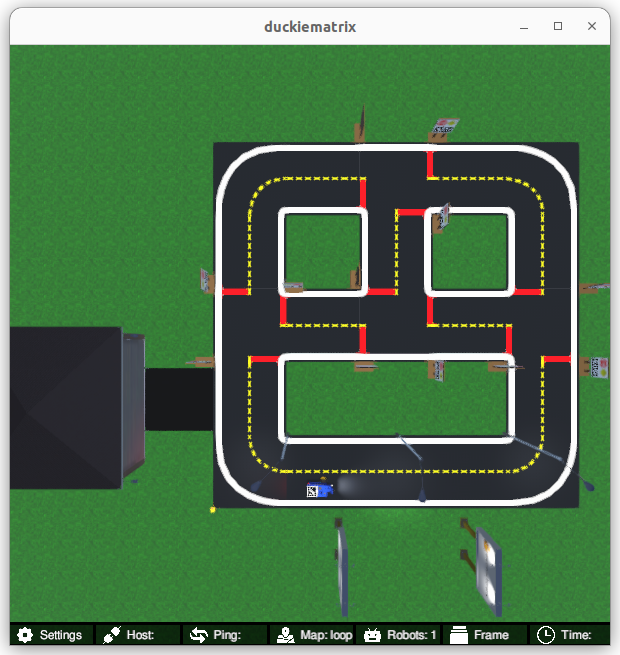

<p align="center">
<a href="https://duckietown.com"></a>
</p>

# **Learning Experience (LX): Localization**


Find the most up-to-date instructions on [how to run LXs on the Duckietown manual](https://docs.duckietown.com/ente/duckietown-manual/60-learning-experiences/lx-general-procedure.html). 

# About these activities

This learning experience is about how we should use the data streaming through the sensors, together with the knowledge
of our surroundings, to estimate our state. The so-called optimal approach to this is the Bayes filter, however, 
this approach is computationally intractable in all but the simplest settings. We will explore several approximations
to the Bayes filter. Namely, the Kalman filter, the particle filter, and the histogram filter. Each has its own
assumptions and conditions under which it is most applicable. Finally, you will program an extended Kalman filter, 
or EKF, to localize your Duckiebot using the data from the wheel encoders and the AprilTag fiducial markers that you
observe at known locations.

This learning experience is provided by the Duckietown team and can be run on Duckiebots. Visit us at the 
[Duckietown Website](https://www.duckietown.com) for more learning materials, documentation, and demos.

For guided setup instructions, lecture content, and more related to this LX, 
see [our Self-Driving Cars with Duckietown MOOC on EdX](https://duckietown.com/self-driving-cars-with-duckietown-mooc/).

**(If not already done) Clone this repository**

The recommended way to use this repository is to make a fork and then clone that fork. 

This can be done through the GitHub web interface. However, you are also free to simply clone this repository and get started. 

Example instructions to fork a repository and configure to pull from upstream can be found in the [duckietown-lx repository README](https://github.com/duckietown/duckietown-lx/blob/mooc2022/README.md).


## 1. Make sure your LX is up-to-date

Update your LX definition and instructions,

    git remote add upstream git@github.com:duckietown/lx-ekf-localization
    git pull upstream ente

## 2. Make sure your system is up-to-date

- 💻 This is an `ente` learning experience (note the branch name). Make sure your Duckietown Shell is set to an `ente` profile 

- (and not, e.g., a `daffy` one). You can check your current distribution with

    dts profile list

  To switch to an ente profile, follow the [Duckietown Manual DTS installation instructions](https://docs.duckietown.com/ente/duckietown-manual/10-setup/02-software/duckietown-shell-dts-installation.html#dt-account-switch-profile).


- 💻 Always make sure your Duckietown Shell is updated to the latest version: `pipx upgrade duckietown-shell` (see [installation instructions](https://github.com/duckietown/duckietown-shell))

- 💻 Update the shell commands: `dts update`

- 💻 Update your laptop/desktop: `dts desktop update`

- 🚙 Update your Duckiebot: `dts duckiebot update ROBOTNAME` (where `ROBOTNAME` is the name of your Duckiebot - real or virtual.)

- 🚙 If you use a real Duckiebot, make sure its camera is calibrated (intrinsic and extrinsic calibration): every camera is slightly different and mounted slightly differently, and the AprilTag range and bearing measurements used by the EKF are computed with the intrinsic calibration. Follow the [camera calibration instructions](https://docs.duckietown.com/ente/duckietown-manual/20-operations/04-calibrations/duckiebot-camera-calibration.html).

**Note**: if your virtual robot hangs indefinitely when you try to update it, you can try to restart it with:

    dts duckiebot virtual restart ROBOTNAME

- 🚙 This LX runs on ROS 2. Bring the ROS 2 stack of the robot up (real or virtual; the virtual robot still autoboots the ROS 1 stack, so the ROS 2 stack is started explicitly for now):

    dts stack up -H ROBOTNAME ros2/duckiebot
    dts stack up -H ROBOTNAME ros2-core/default


## 3. Work on the exercise

### Launch the code editor

#### SSL certificate

If you have not done so already, set up your local SSL certificate needed to run the learning experience editor with:

    sudo apt install libnss3-tools
    dts setup mkcert

Open the code editor by running the following command,

```
dts code editor
```

Wait for a URL to appear on the terminal, then click on it or copy-paste it in the address bar
of your browser to access the code editor. The first thing you will see in the code editor is
this same document, you can continue there.

**NOTE**: if you are running Duckietown inside a devcontainer, make sure to [install the certificate for your host machine as well](https://docs.duckietown.com/ente/duckietown-manual/10-setup/00-computer/setup-duckietown-workspace.html#running-dts-code-editor). 


### Walkthrough of notebooks

**NOTE**: You should be reading this from inside the code editor in your browser.

Inside the code editor, use the navigator sidebar on the left-hand side to navigate to the
`notebooks` directory and open the first notebook.

Follow the instructions on the notebook and work through the notebooks in sequence.


### Testing with the Duckiematrix

It can be useful to test your code in simulation before trying it on the real robot. To test your code in the Duckiematrix you will need a virtual robot. You can create one with the command:

```
dts duckiebot virtual create --type duckiebot --configuration DB21J VBOT
```

where `VBOT` is the hostname. It can be anything you like, with [some constraints](https://docs.duckietown.com/ente/duckietown-manual/10-setup/03-duckiebot/flashing-sd-card-duckiebot-initialization-complete.html). Make sure to remember your robot (host)name for later.

Then you can start your virtual robot with the command:

```
dts duckiebot virtual start VBOT
```

You should see it with a status `Booting` and finally `Ready` if you look at `dts fleet discover`: 

```
     | Hardware |   Type    | Model |  Status  | Hostname 
---  | -------- | --------- | ----- | -------- | ---------
[VBOT] |  virtual | duckiebot | DB21J |  Ready   | [VBOT].local
```

Then start the ROS 2 stack on the virtual robot:

```
dts stack up -H VBOT ros2/duckiebot
dts stack up -H VBOT ros2-core/default
```

Now that your virtual robot is ready, you can start the Duckiematrix. From a terminal in this exercise directory that you 
cloned do:

```
dts code start_matrix
```

You should see the Unity-based Duckiematrix simulator start up. The startup screen will look like:


Your Duckiebot is at the start of a long straightaway with duckies crossing the road. 

Remember that to activate the Duckiematrix window, click anywhere on it and press [ENTER]. You can then at any time press `ESC` to disengage the mouse. 

From here you can move the duckie towards the Duckiebot with the 'w', 'a', 's', and 'd' keys, or you can move the camera angle to view the Duckiebot with the mouse. If you are close enough to your Duckiebot, you can jump on with the 'E' key. You can then drive the Duckiebot around with the 'w', 'a', 's', and 'd' keys. All available keyboard commands are summarized in the "Settings" tab at the bottom left of the Duckiematrix window. 


You can then drive the Duckiebot around with the 'w', 'a', 's', and 'd' keys. You'll notice that this map includes traffic signs with fiducial 
markers ([AprilTags](https://april.eecs.umich.edu/software/apriltag)) that we are going to use in this exercise to help localize your robot. 

You can also switch to a top-down view of the map by pressing the 'v' key, which gives a view similar to this one:



If you get very lost from the road and you want to come back, you can do so with the 'R' key (note that you should do this for the exercise before testing every time since the initial state estimate coincides
with the reset position). 

### Building your code

After going through the notebooks, at any time you can compile your code in a Docker image with:

```
dts code build -R ROBOT_NAME 
```

where `ROBOT_NAME` is the name of your real or virtual robot.

### 💻 Testing 

Test your code on the virtual Duckiebot in the Duckiematrix:

```
dts code workbench -m -R [VIRTUAL_ROBOT_NAME]
```

To test it on a physical Duckiebot instead:

```
dts code workbench -R [ROBOT_NAME]
```

This runs the `ekf_localization_node` on the robot (`[ROBOT_NAME]` is the real or the virtual robot, use whichever you ran the `dts code build` command with). 
The node publishes your pose estimate with its covariance on `/ROBOT_NAME/ekf_localization_node/pose` (`nav_msgs/Odometry`), the landmarks of the map on `/ROBOT_NAME/map_markers` (`visualization_msgs/MarkerArray`, green markers that turn blue while the corresponding AprilTag is detected) and the camera image with the detected tags on `/ROBOT_NAME/ekf_localization_node/debug/detections/compressed`.

The visualization lives in the [EKF notebook](./notebooks/04-ekf-localization/ekf_localization.ipynb): its last cells connect to the robot (`RosSession(ROBOT)`) and show, live inside the code editor, the trajectory of your estimate with its covariance ellipse (purple) and the landmarks, the detections image, a panel to change the filter parameters (noise covariances, initial pose, `no_predict`/`no_update`) while the node runs, and a `reset` button that re-initialises the filter. In the Duckiematrix the ground truth pose (`/ROBOT_NAME/duckiematrix_interface_node/state`) can be plotted as well: it should stay inside the covariance ellipse if your implementation is correct.

The detections image should look like this:


A terminal inside the code editor is already connected to the robot (set `ROBOT` in the notebook, or export `VEHICLE_NAME`), so you can also inspect everything from the command line: `ros2 topic list`, `ros2 topic echo /ROBOT_NAME/ekf_localization_node/pose`, `ros2 node list`, `ros2 param list /ROBOT_NAME/ekf_localization_node`, `ros2 param set /ROBOT_NAME/ekf_localization_node no_update true`, `ros2 service call /ROBOT_NAME/ekf_localization_node/reset std_srvs/srv/Trigger`.

You should now use the keyboard (`dts duckiebot keyboard_control ROBOT_NAME`, or the Duckiematrix window) to pilot your robot and test the localization performance
of your Duckiebot as it moves.

Now you can proceed to the [first notebook](./notebooks/01-kalman-filter/kalman-filter.ipynb).

# Credits

The Kalman filter and particle filter notebooks were created by [Rey Reza Wiyatno](https://rrwiyatn.github.io/)
